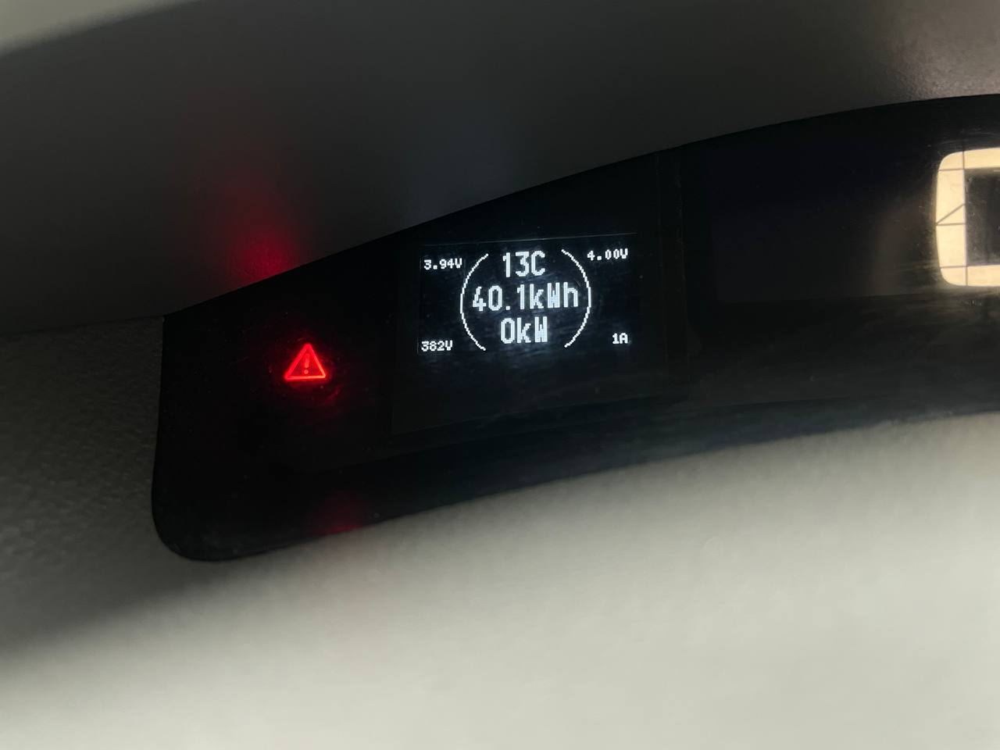

# Nissan Leaf Advanced CAN Dashboard

An Arduino-based CAN dashboard for the Nissan Leaf, featuring real-time battery monitoring, driving statistics, and additional battery telemetry.

The project uses an MCP2515 CAN controller and a 128×64 OLED display to provide useful information about the vehicle and its high-voltage battery.

## Features

- Real-time battery State of Charge (SOC).
- Remaining battery energy (kWh).
- Estimated driving range (km).
- Battery voltage and current.
- Instantaneous battery power (kW).
- GIDs monitoring and percentage calculation.
- Configurable energy consumption (km/kWh).
- Maximum GIDs learning and EEPROM storage.
- Battery cell minimum and maximum voltage monitoring.
- Average battery temperature.
- Battery capacity monitoring (Ah).
- Cell voltage imbalance monitoring.
- Contactor and full-charge status.
- Battery learning status indicators.
- Temperature spike filtering and averaging.
- FIFO CAN message processing.
- Six display pages.
- Settings and calibration data stored in EEPROM.

## Hardware Requirements

- Arduino-compatible microcontroller.
- MCP2515 CAN module with an 8 MHz crystal.
- SH1106 OLED display (128×64, I2C).
- Nissan Leaf CAN bus connection.

| CAN ID | Description |
|---|---|
| 0x11A | Gear selector position |
| 0x1DB | Battery voltage and current |
| 0x5BC | Battery GIDs |
| 0x55B | Vehicle SOC |
| 0x6A0 | Additional battery telemetry from the custom CAN bridge |

## Additional Battery Telemetry — CAN ID 0x6A0

One of the main features of this project is integration with my custom Nissan Leaf CAN Bridge.

The dashboard receives additional battery information through CAN identifier **0x6A0**.

This message contains 8 bytes:

| Byte | Description | Data format |
|---|---|---|
| Byte 0 | Average battery temperature | Signed 8-bit integer (°C) |
| Byte 1 | Remaining battery capacity | Unsigned 8-bit integer (Ah) |
| Byte 2 | Cell voltage imbalance | Unsigned 8-bit integer (mV) |
| Bytes 3–6 | Minimum and maximum cell voltage | Two packed 13-bit values (mV) |
| Byte 7, bit 0 | Main contactors status | 1 = ON, 0 = OFF |
| Byte 7, bit 1 | Full charge status | 1 = Full, 0 = Not full |
| Byte 7, bit 2 | Lower battery limit learned | 1 = Learned |
| Byte 7, bit 3 | Upper battery limit learned | 1 = Learned |
| Byte 7, bits 4–7 | Reserved | Unused |

### Cell Voltage Encoding

Bytes 3–6 contain two 13-bit voltage values packed into a 32-bit big-endian container.

- Bits 25–13: Minimum cell voltage (mV).
- Bits 12–0: Maximum cell voltage (mV).

### Temperature Filtering

Battery temperature is filtered to prevent incorrect readings caused by temporary CAN data glitches.

The filtering algorithm uses:

- A moving average of the last 3 temperature measurements.
- Detection of sudden temperature changes greater than 5°C.
- Confirmation using 3 consecutive measurements.
- A candidate tolerance of 2°C.

This prevents unrealistic temperature jumps from appearing on the display while allowing genuine temperature changes to be registered.

**Important:** The dashboard requires a compatible CAN bridge transmitting telemetry using CAN ID `0x6A0` to display this additional information.

## Display Pages

The dashboard provides six display pages:

1. **Range / SOC** — Estimated driving range, battery SOC and remaining energy.
2. **Power** — Instantaneous battery power, voltage and current.
3. **Range** — Large estimated driving range display.
4. **Battery** — Battery temperature, energy, power, minimum and maximum cell voltage, pack voltage and current.
5. **Telemetry** — Additional battery information received from the custom CAN bridge.
6. **Diagnostics** — GIDs, maximum GIDs, initial GIDs, boot counter and SOC information.

## Display Navigation

The dashboard uses the vehicle's original gear selector to navigate between display pages.

To enter selection mode:

**P → N → P → N**

Once selection mode is activated:

- R — Previous page.
- D — Next page.
- P — Confirm selection.

The selected page is saved in EEPROM and restored after restarting the Arduino.

## EEPROM Storage

The project stores configuration and historical data in EEPROM:

- Selected display page.
- Average energy consumption (km/kWh).
- Maximum GIDs (16-bit value).
- Boot counter.
- Initial GIDs recorded after startup.

This allows the dashboard to retain important settings and battery-related information after power cycles.

## Required Arduino Libraries

Install the following libraries:

- [U8g2 Graphics Library](https://github.com/olikraus/u8g2)
- [MCP_CAN Library](https://github.com/coryjfowler/MCP_CAN_lib)

The Arduino EEPROM and Wire libraries are included with the Arduino environment.

## Related Project — Custom Nissan Leaf CAN Bridge

This dashboard uses additional battery telemetry provided by my custom Nissan Leaf CAN Bridge.

**CAN Bridge Repository:** https://github.com/petruxa007/CAN-Bridge-Battery-Upgrades-Nissan-Leaf-Aze0

The bridge provides additional battery information that is not available through the standard dashboard data used by this project.

Please note that the additional telemetry features require a compatible version of the CAN bridge firmware.

## Credits and Project Distribution

**This project is distributed completely free of charge.**

It was assembled and developed using code, ideas, and components from several existing open-source projects and contributions from other developers.

I believe that projects built upon the work of the open-source community should remain accessible to everyone.

All original authors retain credit for their respective contributions. Please refer to the original projects and their licenses when using or modifying their work.

This project is provided as-is, without any warranty.

## Disclaimer

This is an experimental, community-oriented project for Nissan Leaf owners.

Always verify CAN connections, hardware compatibility and displayed battery information before relying on the data.

The author is not responsible for damage caused by incorrect wiring, hardware modifications or software use.
